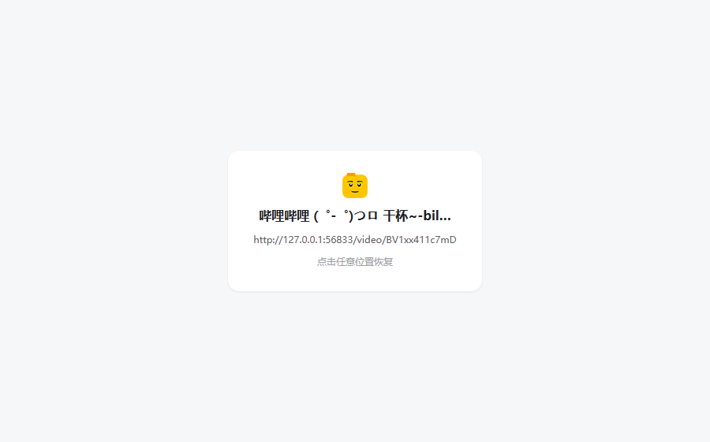

# Tab Suspender Lite

一个极简的 Chrome 标签页冻结扩展：把暂时不用的标签页换成一张轻量占位页，点击占位页即可恢复（`data:` 页面会在紧邻的新标签页中打开）。

目标是**最小实现、最小内存占用**：没有框架、没有字体、没有 content script、没有后台轮询、没有 `storage` 依赖。



## 特性

- **冻结当前标签页** `Ctrl+Shift+F`（macOS: `⌘+Shift+F`）
- **冻结当前窗口内除当前页外的所有标签页**（**默认不绑定快捷键**，需手动配置）
  - 原因：`Ctrl+Shift+G` 是 Chrome 内置的「查找上一个」，Chrome 不允许扩展占用，因此该命令初始不设默认快捷键
  - 配置位置：`chrome://extensions/shortcuts`；实测可用的组合例如 `Alt+Shift+G`、`Ctrl+Shift+H`、`Ctrl+Shift+U`
  - 跳过当前标签页
  - 跳过所有固定（pinned）标签页
  - 跳过浏览器内部页面：`chrome://*`、`devtools://*`、`chrome-untrusted://*`、`chrome-search://*`、扩展页面、`about:`（`about:blank` 除外）
  - 跳过已经是占位页的标签页
- **支持冻结 `http(s)`、`file:`、`view-source:`、`about:blank`、`blob:`、`data:` 等所有非内部页面**
- **恢复方式按页面类型自动选择**：
  - 普通页面：点击占位页任意位置（或 Enter / Space）原地恢复
  - `data:` 页面：Chrome 不允许把已有标签页导航到 `data:` URL，因此点击占位页里的地址，会在**紧邻当前标签页后方**打开一个新标签页来加载它（占位页保留，不自动关闭）
  - 其余非 http(s) 页面：由后台用 `chrome.tabs.update` 恢复（`location.replace` 无法导航到 `file:`、`view-source:` 等地址）
- 占位页展示：站点图标（32px）、标题（超过 20 字符截断）、URL（超过 50 字符截断）
  - 标题与 URL 的完整内容放在原生 `title` 属性里，鼠标悬停可看全文；标签栏标题也保留完整标题
  - `data:` 页面会在占位页上提示「data: 类型地址无法原地恢复，将在新标签页中打开」，地址文字可点击
- 不主动丢弃占位页，交给 Chrome 自己的内存管理；占位页本身只有几 KB

## 安装（开发者模式）

1. 打开 `chrome://extensions`
2. 右上角开启「开发者模式」
3. 点击「加载已解压的扩展程序」，选择本仓库根目录

快捷键可在 `chrome://extensions/shortcuts` 修改；其中「冻结其他标签页」默认未绑定，需要在那里手动设置。

## 占位页 URL 结构

冻结后的标签页 URL 形如：

```
chrome-extension://<extension-id>/suspended.html?url=<encodeURIComponent(original-url)>&title=<encodeURIComponent(original-title)>
```

设计参考了 [Tab Suspender](https://chromewebstore.google.com/detail/tab-suspender/laameccjpleogmfhilmffpdbiibgbekf)，但去掉了 `time` 参数：

- **标签页自描述**：原 URL 和标题都编码在标签页自己的 URL 里，不需要 `chrome.storage`，也不怕 MV3 service worker 被随时终止；浏览器重启后 session restore 也能正确恢复。
- **无状态后台**：service worker 只负责「把标签页导航到占位页」和响应占位页的恢复请求；后台不维护 tabId → URL 的映射，因此不需要处理标签页换 id、worker 重启等状态问题。`http(s)` 的恢复由占位页自己 `location.replace`，其余类型由占位页发消息给 worker 执行（`file:` / `view-source:` / `about:blank` / `blob:` 用 `chrome.tabs.update`，`data:` 用 `chrome.tabs.create` 开新标签）。
- **图标不写进 URL**：占位页加载时用 [`_favicon`](https://developer.chrome.com/docs/extensions/how-to/ui/favicons) 按目标 URL 向 Chrome 的本地 favicon 缓存取图，不访问原网站，也不生成 data URI。

## 设计取舍

| 选择 | 原因 |
| --- | --- |
| 用扩展占位页，而不是 `data:text/html` | 扩展无法把已有标签页导航到 `data:` URL；即使绕道新建标签页，`data:` 页面也是独立 opaque origin，会为每个挂起页单独占用一个渲染进程，内存反而更高，且拿不到 `chrome.*` API、无法用 `_favicon`。 |
| 不调用 `chrome.tabs.discard` 丢占位页 | 保留「切过去就能看到图标/标题/URL」的体验；占位页只有几 KB，Chrome 在内存压力下会自行丢弃它（丢弃后激活重载占位页，仍可点击恢复）。 |
| 无 content script / 无 storage | 极简，权限最小；代价是恢复后无法保留滚动位置和表单内容（浏览器重载页面的固有行为）。 |
| 无框架、无外部字体、无图片资源 | 占位页只有一个 HTML + 一个几 KB 的 JS，CSS 内联；favicon 直接指向 `_favicon` URL，不做 fetch/canvas。 |
| http(s) 恢复用 `location.replace` | 用原页面替换占位页，避免占位页留在前进/后退历史里。 |
| 其余类型恢复交给 service worker | 渲染进程不能导航到 `file:` / `view-source:` 等地址；`data:` 更是被 Chrome 禁止在已有标签页中打开，只能新建标签页。 |
| 跳过浏览器内部页面 | `chrome://`、`devtools://` 等页面无法安全恢复（导航可能被拒绝，页面状态也会丢失），因此不冻结。 |
| 超长 URL 不预判，交给 Chrome 拒绝 | 占位页 URL 超过 Chrome 的约 2 MiB 导航上限时，`chrome.tabs.update` 会以 `Navigation rejected.` 拒绝；捕获后跳过该标签页，不产生无法恢复的占位页。 |
| 不引入 storage | 保持占位页自包含：URL 与标题全在地址里，浏览器重启/崩溃后仍可恢复。 |

## 权限

- `tabs`：读取标签页的 `url` / `title` / `pinned`，并更新标签页 URL。
- `favicon`：使用 `_favicon` 读取 Chrome 本地缓存的站点图标（与 `tabs` 一起声明不会额外弹权限警告）。

没有 host permissions，不会读取或修改任何网页内容。

## 目录结构

```
.
├── manifest.json      # MV3 清单：权限、快捷键、图标
├── background.js      # service worker：冻结逻辑、恢复请求处理、两个命令
├── suspended.html     # 占位页（内联 CSS，无外部依赖）
├── suspended.js       # 占位页逻辑：读 URL 参数、取图标、点击恢复
├── icons/             # 16/32/48/128 扩展图标
├── README.md
└── LICENSE
```

## 已知限制

- 不冻结浏览器内部页面：`chrome://*`、`devtools://*`、`chrome-untrusted://*`、`chrome-search://*`、扩展页面、`about:`（仅 `about:blank` 例外）。
- 只有 `data:` 页面不能原地恢复：点击占位页里的地址会在紧邻当前标签页后方打开一个新标签页；占位页保留，不自动关闭。
- `blob:` 页面只有在它的创建者（creator）仍然存活时才能恢复；creator 已关闭、或 creator 就是被冻结的这个标签页本身时，恢复只能看到 Chrome 错误页（新标签页也一样）。
- 页面 URL 特别长时（占位页 URL 超过 Chrome 约 2 MiB 的导航上限），冻结会被 Chrome 以 `Navigation rejected.` 拒绝，该标签页会被静默跳过（仅控制台日志）。
- 带 `beforeunload`（未保存提示）的页面在冻结时可能弹出浏览器的离开确认；用户取消则冻结不生效、页面保持原样。
- “冻结其他标签页”只作用于**当前窗口**。
- 恢复是重新加载原 URL，不保留滚动位置、表单内容、SPA 内部状态（这是所有“换页式”冻结方案的共同代价）。
- 占位页被 Chrome 自动丢弃后，切换到该标签页会先重新加载占位页，再点击恢复。
- Chrome 156 上 `chrome.tabs.discard` 会让标签页换新 id（本项目不依赖 tabId，因此不受影响；如果你要加自动丢弃/统计功能需注意）。

## 开发

无构建步骤，改完文件后在 `chrome://extensions` 点扩展卡片上的「重新加载」即可。

调试提示：

- MV3 扩展页面的默认 CSP 禁止内联 `<script>`，所以占位页逻辑必须放在 `suspended.js` 里（CSS 可以内联）。
- 占位页的 favicon 用 `chrome.runtime.getURL('/_favicon/')` 构造，离开扩展上下文（如普通网页）无法使用。
- `background.js` 末尾把两个冻结函数挂到了 worker 的全局对象上，便于在 service worker 控制台里手动调用测试。

## 已验证行为（Chrome 156 / Windows）

- `Ctrl+Shift+F` 默认绑定成功；「冻结其他标签页」默认不绑定快捷键（`Ctrl+Shift+G` 被 Chrome 保留，扩展无法占用），可在 `chrome://extensions/shortcuts` 手动配置
- 冻结后 URL 为 `suspended.html?url=...&title=...`，不含 `time`
- 占位页：完整标题写入 `document.title`，可见标题截断到 20 字符、URL 截断到 50 字符，完整值在 `title` 属性
- 图标来自 `_favicon`（32×32），`<link rel=icon>` 与 `` 使用同一 URL，标签栏图标正常
- `http(s)` 页面：点击占位页任意位置原地恢复（标签页 id 不变）；`Enter` / `Space` 也可
- `data:` 页面：占位页显示「data: 类型地址无法原地恢复，将在新标签页中打开」，地址文字可点击；点击地址在**紧邻位置（index+1）**打开新标签页并激活，占位页保留；点击其它区域无动作
- `file:`、`view-source:`、`about:blank`、`blob:`（creator 仍存活时）均可通过占位页 → service worker 恢复，标签页 id 不变
- 跳过：`chrome://*`、`devtools://*`、`chrome-untrusted://*`、`chrome-search://*`、扩展页面、`about:`（`about:blank` 除外）、空 URL、已冻结页
- 占位页 URL 超过 Chrome 的 2,097,152 字符上限时，`chrome.tabs.update` 抛 `Navigation rejected.`，被捕获后跳过该标签页（不产生占位页）
- “冻结其他标签页”跳过当前页、固定页、内部页与已冻结页；重复执行返回 0
- 扩展没有 `storage` 权限（`chrome.storage` 为 undefined），后台不保存任何状态

## 后续可选

- 自动冻结（空闲计时 / 内存压力 / 系统内存低）
- 滚动位置与表单内容恢复
- 白名单、按域名规则
- 右键菜单、弹窗面板
- i18n

## License

[MIT](LICENSE)

> 图标素材取自 Tab Suspender 扩展（Chrome 应用商店）的安装包，仅用于本地/个人项目；如需公开发布，请替换为自己的图标。
